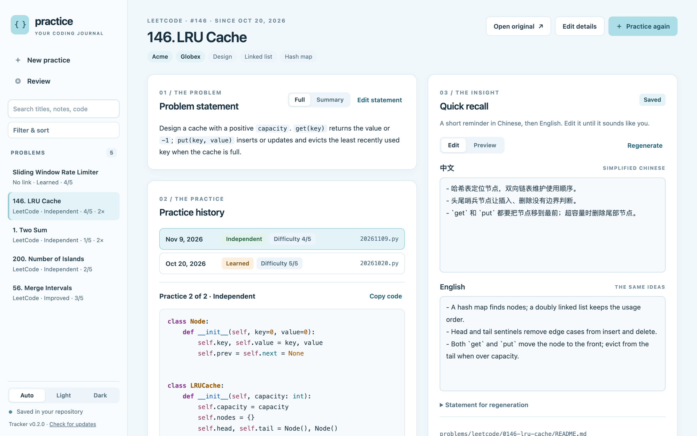
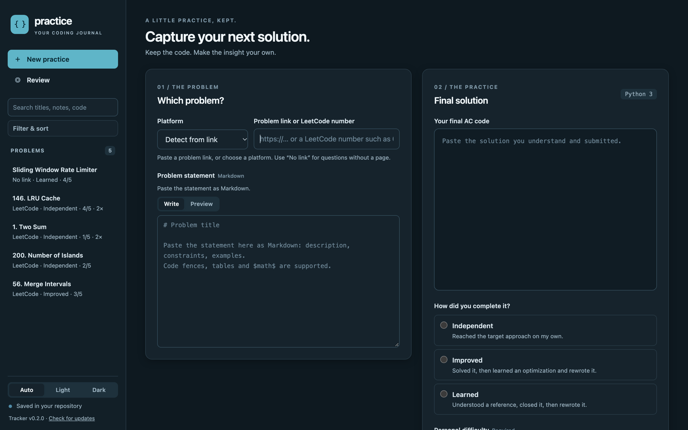
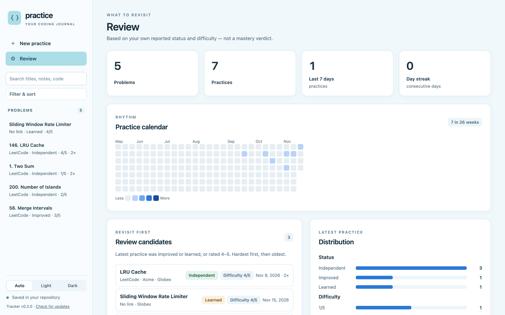
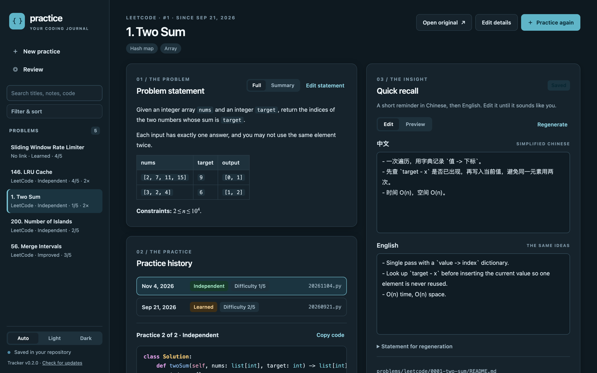

# Coding Practice Tracker

English | [简体中文](README_zh.md)

A local Python coding practice journal: save the final solution you understand and report as Accepted, preserve your original notes, and revisit the approach with bilingual Quick recall.

Use the browser workspace or terminal workflow with the Python standard library. No Python dependencies, frontend build, or database setup is needed. This public repository starts with **0 problems and 0 practices**, with no personal solution history included.



## Features

- **Archive from many platforms**: LeetCode (`leetcode.com` and `leetcode.cn`), Hack2Hire, LintCode, NeetCode, HackerRank, CodeSignal, GeeksforGeeks, 1Point3Acres, any other website, or a question with no link at all. Archived solutions currently use Python.
- **Record the process**: choose `independent`, `improved`, or `learned`, plus a required personal difficulty from 1–5 for each practice. One Accepted submission does not establish permanent mastery.
- **Keep the originals**: dated solution files never overwrite earlier attempts, personal notes are preserved verbatim, and statements you paste are stored as Markdown in the problem's README.
- **Build recall**: generate Chinese and English reminders through your own Codex CLI, then edit, preview, and save them in the browser.
- **Browse and review**: every problem has its own page with practice history and highlighted code; the sidebar searches and filters by platform, status, difficulty, company, and tag; the Review page shows a practice calendar and review candidates.
- **Stay up to date**: the app tells you when a new release is available and installs it with one click, without touching your records.

## Screenshots

| New practice (dark theme) | Review |
| --- | --- |
|  |  |



The screenshots use made-up demo practices.

## Quick start

Requirements: **Python 3.11+ and curl** on macOS or Windows 10+ (both ship curl). AI generation requires a separately installed, logged-in Codex CLI; no API key belongs in this project. The browser workflow attempts AI generation after saving. To archive without AI, use the terminal's `--no-ai` option.

```bash
git clone https://github.com/HelloLindo/coding-practice-tracker.git
cd coding-practice-tracker
python3 --version   # 3.11 or newer
./web.command
```

If `python3 --version` reports an older Python (the copy bundled with Apple's Command Line Tools can be), install a current one from [python.org](https://www.python.org/downloads/). On Windows, double-click `web.cmd` instead. Your browser opens `http://127.0.0.1:8765/`. On macOS you can also double-click `web.command` in Finder. Keep the window open while using the app; press Ctrl-C to stop it.

1. Solve a problem on the practice platform, obtain Accepted, and make sure you understand the solution.
2. Paste the problem link (or a LeetCode number). The platform is detected from the link, and the page says whether the problem is new or already archived.
3. For a new non-LeetCode problem, enter its title and paste the statement as Markdown. LeetCode statements are looked up automatically.
4. Paste your final code, choose a practice status and personal difficulty, and optionally add original notes.
5. Select **Archive practice**. Code and notes are saved first; Quick recall is generated in the background.
6. Edit the Chinese and English reminders on the problem page, then select **Save recall** or press Cmd/Ctrl-S.

If generation fails, your saved practice remains available. Write recall manually or select **Regenerate** later. The tool does not verify Accepted through your platform account or execute pasted solutions.

```bash
# Use a different port if the default is occupied.
./web.command --port 8766

# Choose a model available to your CLI account; replace MODEL_ID.
./web.command --model MODEL_ID

# Archive interactively in the terminal without AI generation (practice.cmd on Windows).
./practice.command --no-ai

# View progress without calling a model.
python3 scripts/report.py
```

The default model is `gpt-6-luna` with the CLI's default reasoning effort. To choose another model or effort for your workspace, create `settings.json` in its root (your own file; updates never change it):

```json
{"model": "MODEL_ID", "reasoning_effort": "medium"}
```

`--model` / `--effort` and the `PRACTICE_MODEL` / `PRACTICE_EFFORT` environment variables override it for one run. Model availability depends on your installation and account. Set a custom CLI executable with `PRACTICE_CODEX`. The browser has no separate switch to disable AI generation; use the terminal workflow above when the CLI is unavailable.

See the [full user guide](docs/USER_GUIDE.md) for supported platforms, the problem page, file-based input, summary retries, conflict handling, upgrades, and the main options.

## Practice statuses

| Status | What happened during this practice |
| --- | --- |
| `independent` | Independently reached the target approach and obtained AC. |
| `improved` | Independently obtained AC, learned an optimization, then closed the reference and rewrote the improved solution to AC. |
| `learned` | Could not solve independently; understood a reference, closed it, then implemented the solution to AC. |

Personal difficulty rates the effort to understand and implement this solution, from 1 (easiest) to 5 (hardest). It is separate from the platform's difficulty. All practice statuses are user-reported.

## Where your data lives

```text
problems/<platform>/<folder>/
  problem.json    # Identity: platform, title, URL, companies, tags, related problems
  README.md       # Source, statement, recall, and dated original notes
  YYYYMMDD.py     # Practice status, difficulty, and final code
```

LeetCode folders are named like `0001-two-sum`; other folders are `<title-slug>-<hash>`, and a folder name never changes after creation. Another practice on the same date creates a new file such as `_02.py`. Archive dates use the `America/Los_Angeles` timezone. `plans/` holds optional plans, and `STYLE.md` holds conventions you approve; neither requires daily upkeep.

The browser service listens only on `127.0.0.1` and provides no public hosting or multi-user accounts. Project files stay on your machine. LeetCode lookups contact LeetCode; other platforms' pages are never scraped. AI generation sends the current problem's source text, code, and notes to your own Codex CLI, consuming your account's model allowance. Browser form drafts persist in the current tab's session storage. The update check is described below.

## Updates

When `web.command` starts, it asks GitHub at most once a day whether this project has published a newer release. If one exists, the page shows a banner with **What's new** and **Update now**. Updating:

- downloads the release from this GitHub repository and checks every file against its manifest;
- replaces only the tool files listed in `tracker-manifest.json`, so `problems/`, `plans/`, `STYLE.md`, `settings.json`, `.cache/`, and `.git/` are never touched;
- keeps documents you edited yourself (such as README or AGENTS.md), and saves the release's version under `.cache/update/` so you can compare them;
- stops if you edited tool code (`scripts/`, `web/`, `tests/`, launchers), because mixing versions could break the tool; `python3 scripts/update.py --replace-modified` backs up your versions under `.cache/update/` and installs the release's;
- never commits or pushes. Review the result with `git status` and commit it yourself.

After installing, select **Restart now**, and the page reloads with the new version. If a release changes how records are stored, the page offers **Upgrade records** and lists what will change before anything is written.

From a terminal:

```bash
python3 scripts/update.py --check   # report whether a newer release exists
python3 scripts/update.py           # list the changes, then ask before installing
```

The check sends one anonymous request to `api.github.com`, with no practice data. Turn the automatic check off with `./web.command --no-update-check` or `PRACTICE_NO_UPDATE_CHECK=1`; the **Check for updates** link at the bottom of the sidebar still works.

**Copies made before the updater existed (v0.1.0)** need this once, run from the copy's folder:

```bash
curl -fsSL https://raw.githubusercontent.com/HelloLindo/coding-practice-tracker/main/scripts/update.py -o scripts/update.py
python3 scripts/update.py
python3 scripts/migrate.py --apply   # after reviewing its dry run
```

## Keep your own practice records

This public project distributes the tool. Create a separate **private repository** for your code and notes, and keep personal practices out of this project's public repository.

Select **Use this template → Create a new repository** on GitHub ([create a copy](https://github.com/new?template_name=coding-practice-tracker&template_owner=HelloLindo)), name your copy, choose **Private**, and clone your new repository. The tool and your records will then live in your own private workspace, and the built-in updater keeps the tool current.

Alternatively, create an empty private GitHub repository such as `my-coding-practice`, download and extract this project's ZIP, and run these commands in the extracted directory:

```bash
git init -b main
git add .
git commit -m "Initialize personal coding practice workspace"
# Replace this URL with your own new private repository.
git remote add origin https://github.com/YOUR_USERNAME/my-coding-practice.git
git push -u origin main
```

Before pushing, confirm that `origin` points to your own private repository and review the files being uploaded. The app never runs Git operations automatically.

## Scope and limitations

- Works on macOS and Windows with only Python 3.11+; Linux is tested in CI. Validate other systems for your own workflow.
- LeetCode interfaces may change or reject requests. Supply an exact URL, title, and pasted statement when needed. Missing source content stays pending rather than receiving invented constraints.
- Review AI output yourself. There is no built-in judge, solution collection, or multi-user synchronization service.
- Keep credentials, restricted problem statements, employer code, and other people's private materials out of commits.

## Development and contributions

```bash
python3 -m unittest discover -s tests -v
python3 scripts/release.py --check
```

Tests use temporary directories and synthetic fixtures. After changing a shipped file, run `python3 scripts/release.py` to refresh the update manifest. Issues and improvements are welcome; see [Contributing](CONTRIBUTING.md). Report security concerns privately as described in the [security policy](SECURITY.md).

## License

The project's tool code and documentation use the [MIT License](LICENSE), allowing use, modification, and redistribution with the copyright and license notice retained.

Third-party names, problems, and platform content belong to their respective rights holders and are not licensed under MIT by this project. This project is not affiliated with or endorsed by LeetCode, Hack2Hire, or any other practice platform. You decide how to share your own solution code and notes.
