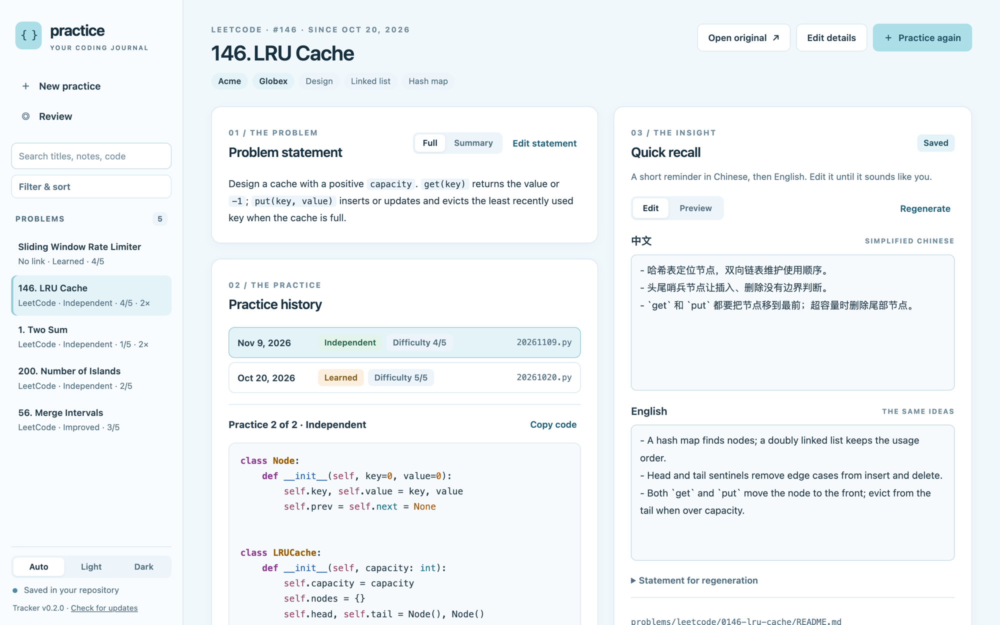
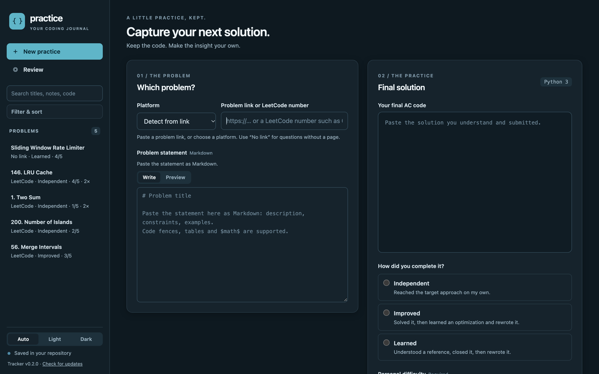
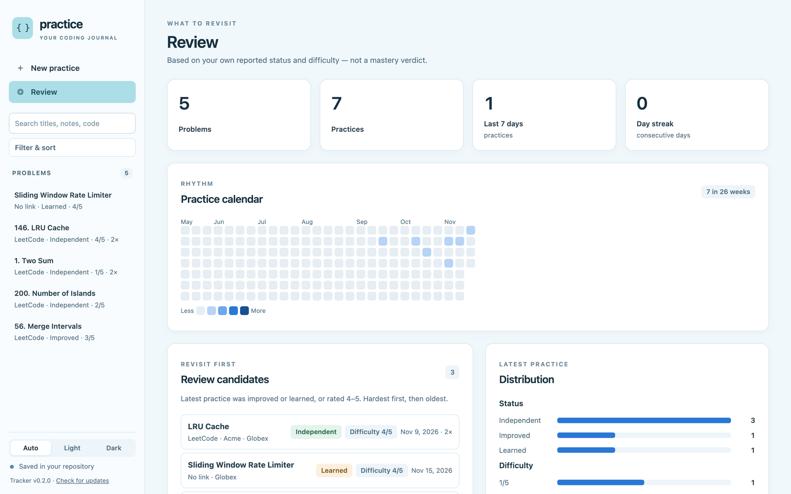
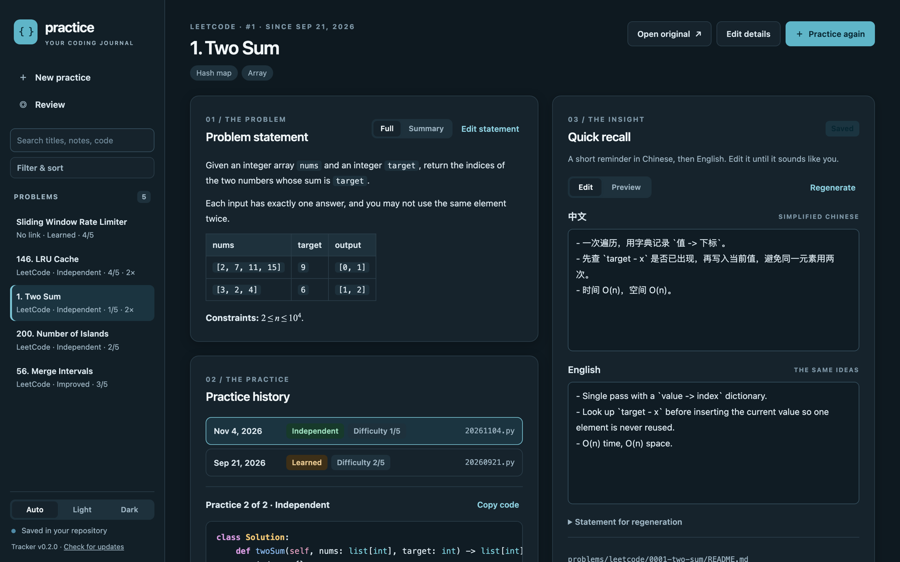

# Coding Practice Tracker

[English](README.md) | 简体中文

一个在本机运行的 Python 刷题记录工具：保存最终理解并通过的代码、原始笔记和每次练习的状态，用中英双语 Quick recall 帮助之后复习。

开箱即用的本地网页 + 终端流程，使用 Python 标准库，无需安装 Python 依赖、构建前端或配置数据库。公开仓库从 **0 道题、0 次练习** 开始，不包含作者的个人解题记录。



## 能做什么

- **多平台归档**：LeetCode（`leetcode.com` 与 `leetcode.cn`）、Hack2Hire、LintCode、NeetCode、HackerRank、CodeSignal、GeeksforGeeks、一亩三分地、任意其他网站，或完全没有链接的题目。目前归档语言为 Python。
- **记录过程**：每次选择 `independent`、`improved` 或 `learned`，以及必填的个人难度 1–5；不把一次通过当作永久掌握。
- **保留原文**：日期命名的代码文件不会覆盖旧解法，个人笔记按原文保存，你粘贴的题目原文以 Markdown 存进该题的 README。
- **辅助回忆**：通过你自己的 Codex CLI 生成中文 / 英文回忆要点，也可以在网页中编辑、预览和保存。
- **浏览与复习**：每道题都有独立页面，展示练习历史和高亮代码；侧边栏可按平台、状态、难度、公司、标签搜索筛选；Review 页提供练习日历和复习候选。
- **保持最新**：有新版本时页面会提示，一键更新且不会改动你的记录。

## 界面截图

| 新建练习（深色主题） | Review 复习页 |
| --- | --- |
|  |  |



截图中的练习均为演示用的虚构数据。

## 快速开始

需要 **Python 3.11+ 和 curl**，支持 macOS 与 Windows 10+（两者都自带 curl）。AI 生成需要单独安装并登录 Codex CLI；不需要在项目中填写 API key。网页会在保存后尝试 AI 生成；不使用 AI 时可通过终端的 `--no-ai` 归档。

```bash
git clone https://github.com/HelloLindo/coding-practice-tracker.git
cd coding-practice-tracker
python3 --version   # 需要 3.11 或更新版本
./web.command
```

如果 `python3 --version` 显示的版本较旧（Apple Command Line Tools 自带的 Python 可能如此），请从 [python.org](https://www.python.org/downloads/) 安装新版。Windows 上改为双击 `web.cmd`。浏览器将打开 `http://127.0.0.1:8765/`；macOS 也可以在 Finder 双击 `web.command`。使用过程中保持窗口打开，按 Ctrl-C 退出。

1. 在练习平台完成题目，确认 Accepted 且理解解法。
2. 粘贴题目链接（或 LeetCode 题号）。平台会从链接自动识别，页面会提示这是新题还是已归档的题。
3. 非 LeetCode 的新题需填写标题，并以 Markdown 粘贴题目原文；LeetCode 题目会自动查询。
4. 粘贴最终代码，选择练习状态和个人难度，可选填原始笔记。
5. 点击 **Archive practice**。代码和笔记先保存，随后在后台生成 Quick recall。
6. 在题目页编辑中文和英文回忆，点击 **Save recall**（或 Cmd/Ctrl-S）。

如果生成失败，已经保存的练习仍在，可以手工填写回忆或之后 **Regenerate**。工具不登录练习平台验证 Accepted，也不执行你粘贴的代码。

```bash
# 端口被占用时
./web.command --port 8766

# 改用你的 CLI 账号可用的模型（替换 MODEL_ID）
./web.command --model MODEL_ID

# 终端交互入口；跳过 AI 生成也能保存（Windows 用 practice.cmd）
./practice.command --no-ai

# 查看进度，不调用模型
python3 scripts/report.py
```

默认模型是 `gpt-6-luna`。模型和 CLI 参数兼容性取决于你的安装版本及账号；可用 `--model` 或环境变量 `PRACTICE_MODEL` 指定模型，用 `PRACTICE_CODEX` 指定 CLI 路径。网页端没有单独的关闭 AI 开关；没有 CLI 时请用上述终端流程。

查看 [完整使用指南](docs/USER_GUIDE.md)（英文），了解支持的平台、题目页、无交互归档、摘要重试、冲突处理、升级和所有主要参数。

## 练习状态

| 状态 | 这一次练习的过程 |
| --- | --- |
| `independent` | 独立达到目标思路并获得 AC。 |
| `improved` | 先独立 AC，再学习优化，关闭参考后重写优化版并 AC。 |
| `learned` | 未独立解出；理解参考后关闭它，自己实现并 AC。 |

个人难度表示理解和实现这份解法的主观努力，1 最轻松、5 最困难，独立于平台难度。所有状态均为使用者自述。

## 数据放在哪里

```text
problems/<platform>/<folder>/
  problem.json    # 题目身份：平台、标题、URL、公司、标签、关联题
  README.md       # 来源、题目原文、回忆、按日期追加的原始笔记
  YYYYMMDD.py     # 本次状态、难度和最终代码
```

LeetCode 文件夹形如 `0001-two-sum`，其他平台为 `<标题-slug>-<hash>`，创建后不再改名。同日再次练习会生成 `_02.py` 等新文件。归档日期使用 `America/Los_Angeles` 时区。`plans/` 是可选计划，`STYLE.md` 保存你认可的代码约定；它们都不要求日常维护。

网页服务仅监听 `127.0.0.1`，不提供公网托管或多人账号。项目文件保存在本机；查询 LeetCode 题目会访问 LeetCode，其他平台的页面不会被抓取。AI 生成会把当前题目的来源文本、代码和笔记交给你自己的 Codex CLI，使用账号的模型额度。浏览器表单草稿会暂存在当前标签页的 session storage 中。更新检查见下文。

## 更新

`web.command` 启动时，每天最多向 GitHub 查询一次本项目是否发布了新版本。有新版本时页面顶部会出现提示，提供 **What's new** 和 **Update now**。更新时：

- 从本项目的 GitHub 仓库下载对应版本，并按清单校验每个文件；
- 只替换 `tracker-manifest.json` 中列出的工具文件，`problems/`、`plans/`、`STYLE.md`、`.cache/`、`.git/` 永远不会被改动；
- 你自己改过的工具文件会保留，新版本的对应文件放在 `.cache/update/` 供对比；
- 不会 commit 或 push。请用 `git status` 检查后自行提交。

安装完成后点击 **Restart now**，页面会以新版本重新加载。如果新版本改变了记录的存储方式，页面会提供 **Upgrade records**，并在写入前列出所有改动。

终端用法：

```bash
python3 scripts/update.py --check   # 只查看是否有新版本
python3 scripts/update.py           # 列出改动，确认后再安装
```

检查只会向 `api.github.com` 发送一次匿名请求，不包含任何练习数据。可用 `./web.command --no-update-check` 或 `PRACTICE_NO_UPDATE_CHECK=1` 关闭自动检查；侧边栏底部的 **Check for updates** 仍可手动使用。

**在更新功能出现之前创建的副本（v0.1.0）** 需要在副本目录中执行一次：

```bash
curl -fsSL https://raw.githubusercontent.com/HelloLindo/coding-practice-tracker/main/scripts/update.py -o scripts/update.py
python3 scripts/update.py
python3 scripts/migrate.py --apply   # 先看过它的 dry run 输出再执行
```

## 保存自己的练习记录

公开项目用于分享工具。推荐每个人创建独立的 **私有仓库** 保存自己的代码和笔记。不要直接把个人练习推送到本项目。

推荐点击 GitHub 页面右上角 **Use this template → Create a new repository**（[直接创建](https://github.com/new?template_name=coding-practice-tracker&template_owner=HelloLindo)），给副本起名并选择 **Private**，然后 clone 自己的新仓库即可使用。工具和个人记录会直接进入你自己的私有空间，内置的更新功能负责保持工具最新。

也可以在 GitHub 新建自己的空私有仓库（例如 `my-coding-practice`），下载本项目 ZIP 并解压后，在解压目录执行：

```bash
git init -b main
git add .
git commit -m "Initialize personal coding practice workspace"
# 把下面的地址替换为你刚创建的私有仓库地址
git remote add origin https://github.com/YOUR_USERNAME/my-coding-practice.git
git push -u origin main
```

推送前确认 `origin` 指向自己的私有仓库，检查将要上传的文件。应用不会自动执行 Git 操作。

## 适用范围与限制

- 在 macOS 和 Windows 上只需 Python 3.11+；CI 同时在 Linux 上测试。其他系统需自行验证。
- LeetCode 接口可能变化或拒绝访问。可粘贴准确 URL、标题及题目原文；来源缺失时不编造题目约束。
- AI 输出应自行复核。没有内置自动判题、题库答案集或多人同步服务。
- 不要提交账号凭据、受限制的题目原文、雇主代码或他人的私有材料。

## 开发与贡献

```bash
python3 -m unittest discover -s tests -v
python3 scripts/release.py --check
```

测试使用临时目录和模拟数据。修改随工具发布的文件后，运行 `python3 scripts/release.py` 刷新更新清单。欢迎提交问题和改进，具体见 [贡献说明](CONTRIBUTING.md)。遇到安全问题，请按 [安全报告说明](SECURITY.md) 私下反馈。

## 开源许可

本项目的工具代码及项目文档使用 [MIT License](LICENSE)，允许使用、修改和再分发，需保留版权及许可声明。

LeetCode、Hack2Hire 等第三方名称、题目和平台内容归其各自权利人所有，不因本项目而获得 MIT 授权；本项目与这些平台没有隶属或背书关系。你自己的解题代码和笔记由你决定如何分享。
